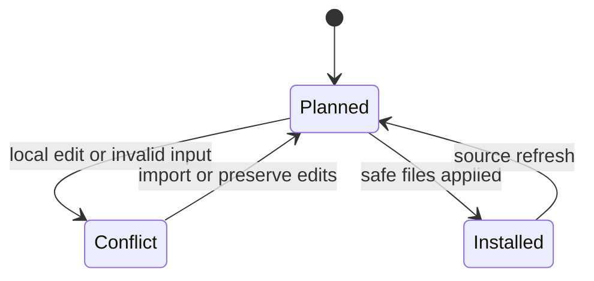

# Agent Herdr

Shared Herdr configuration and custom mods, installed into a separate writable Herdr profile. The repository identity is defined in [sources.json](sources.json). Build identities name the current source repositories, while origin identities name the new public repositories. Historical import revisions and safe adoption hashes live in [provenance.json](provenance.json).

Keep the checkout outside `~/.config/herdr-app`. Herdr writes its own instructions, types, shipped mods, shared state and window state there on startup. The terminal drawer also writes layout files while sessions run. Keeping source separate prevents a Git update from overwriting those files.

Run Herdr once before installation so it creates the platform's default keys and shipped files. With Python 3 available, create a private runtime JSON file outside the checkout:

```json
{
  "sandboxes": [{ "machine": "sandbox", "bot": "assistant" }],
  "controlPath": "/opt/agent-sandbox/session/control.mjs",
  "usageMachine": "quota-source"
}
```

`controlPath` is the absolute path on each sandbox selected by the pane. A nonempty machine name must already be registered with Herdr. Use an empty machine string for the local sandbox, which executes the control command locally. Registration, SSH keys, control installation and source refresh belong to the sandbox provisioner.

```sh
./bin/install --home "$HOME/.config/herdr-app" --profile desktop --runtime "$HOME/.config/agent-herdr/runtime.json"
```

The optional `usageMachine` selects the registered computer that runs the quota collector. An omitted or empty value collects locally. As in the imported mod, an unavailable named source falls back to this computer. Optional `usageHome` supplies an absolute profile path on a remote collector computer when its profile is outside `~/.config/herdr-app`. Local collection always uses the running app's profile. Keep these machine settings private.

An empty sandbox array installs the common mods and shows a setup message in Pots. A headless profile uses `--profile headless` and installs no desktop files. It does not require runtime JSON.

After the provisioner refreshes this checkout, run `bin/update` with the same arguments. It applies the current source without fetching, changing branches or restarting Herdr. Matching files are left untouched to avoid repeated hot reloads. Do not expose a source-read credential to the installer process.



The installer owns the files recorded under `.agent-herdr/` inside the target profile. Existing files are adopted only when identical to the desired content or a recorded upstream import. A changed managed file blocks installation before writes. Newly added local files outside the managed list remain yours. Settings and layouts seed missing files and remain local afterward. Herdr initializes its own platform keys. Existing bindings remain. Custom bindings are defined in `config/keys.json`, where `primary` means Cmd on macOS and Ctrl+Shift on Linux. Occupied keys retain their actions. The terminal drawer's bindings are added only in the installed layouts' scopes.

Pots uses the sandbox pane implementation. The imported Command Center owns its shared UI helpers, and installation copies them into Pots and its terminal mod. It needs no source files from a previous installation. The former dotfiles Pots implementation is replaced only where its recorded import hashes still match. Unrecognized local edits block that replacement.

Every computer runs the same mod code. Platform differences live behind `window().platform` or a command lookup, never in a second copy of a mod. Login shells and the usage collector use zsh when installed and the account's own POSIX login shell otherwise. Bash, sh and zsh are supported. Pots attachments use AppleScript on macOS, and on Linux `zenity` or `kdialog` for the file chooser and `wl-paste` or `xclip` for the clipboard. A missing tool shows an error naming what to install. Key hints read the installed bindings and use the platform's modifier labels. Shared keyboard and UI modules have one source definition and are copied during installation because Herdr loads each mod from its own folder.

Read [the cutover guide](docs/cutover.md) before replacing a previous installer or removing chezmoi ownership. See [AGENTS.md](AGENTS.md) for contributor checks and guarantees.
