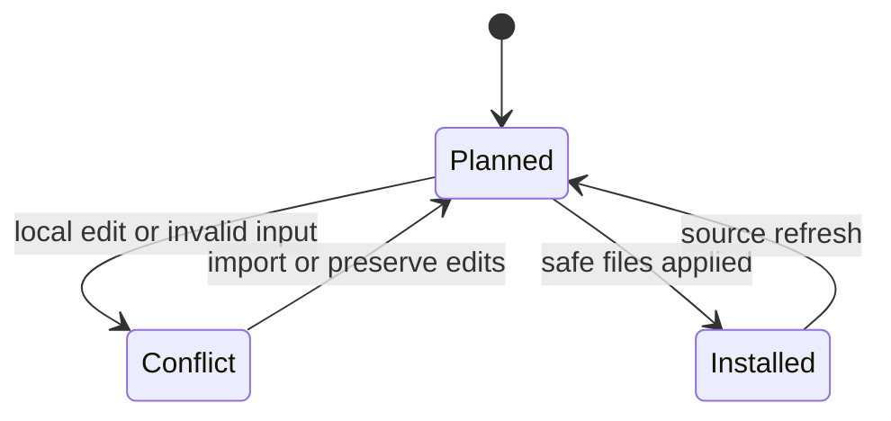

# Agent Herdr

Shared Herdr configuration and custom mods, installed into a separate writable Herdr profile. The repository identity is defined in [sources.json](sources.json). Build identities name the current source repositories, while origin identities name the new public repositories. Historical import revisions and safe adoption hashes live in [provenance.json](provenance.json).

Keep the checkout outside `~/.config/herdr-app`. Herdr writes its own instructions, types, shipped mods, shared state and window state there on startup, and layout clicks while it runs. Keeping source separate prevents a Git update from overwriting those files.

Run Herdr once before installation so it creates the platform's default keys and shipped files. With Python 3 available, create a private runtime JSON file outside the checkout:

```json
{
  "usageMachine": "quota-source"
}
```

A named machine must already be registered with Herdr. Registration, SSH keys and source refresh belong to the sandbox provisioner.

```sh
./bin/install --home "$HOME/.config/herdr-app" --profile desktop --runtime "$HOME/.config/agent-herdr/runtime.json"
```

The optional `usageMachine` selects the registered computer that runs the quota collector. An omitted or empty value collects locally. As in the imported mod, an unavailable named source falls back to this computer. Optional `usageHome` supplies an absolute profile path on a remote collector computer when its profile is outside `~/.config/herdr-app`. Local collection always uses the running app's profile. Keep these machine settings private.

A headless profile uses `--profile headless` and installs no desktop files. It does not require runtime JSON.

After the provisioner refreshes this checkout, run `bin/update` with the same arguments. It applies the current source without fetching, changing branches or restarting Herdr. Matching files are left untouched to avoid repeated hot reloads. Do not expose a source-read credential to the installer process.



The installer owns the files recorded under `.agent-herdr/` inside the target profile. Existing files are adopted only when identical to the desired content or a recorded upstream import. A changed managed file blocks installation before writes. Newly added local files outside the managed list remain yours. Settings seed a missing file and remain local afterward. Herdr initializes its own platform keys. Existing bindings remain. Custom bindings are defined in `config/keys.json`, where `primary` means Cmd on macOS and Ctrl+Shift on Linux. Occupied keys retain their actions.

The installer writes no layout. Herdr's shipped `main` layout is the window, as on a fresh install: spaces by machine, the agents list, tabs and panes. A terminal labelled with `herdr.space` and `herdr.tab`, such as a pot worker, shows there with no custom panel. Every custom mod here declares `place: none`, so Herdr docks none of them, and each appears only where a person adds it to a cloned layout. Layouts already in a profile stay as they are.

Discord manages the pots, so Command Center and the Pots pane are retired. The installer removes their files where they match its receipt or a recorded import hash, and an edited one blocks installation before any write. Layouts and keys that still name them stay until the operator resets the views, as [the cutover guide](docs/cutover.md#retired-views) describes. No mod here closes terminals. Pot workers close through the sandbox's acknowledged-result path, which needs no Herdr window. `agent-lifecycle sweep --apply` closes other finished terminals when a person runs it.

Every computer runs the same mod code. Platform differences live behind `window().platform` or a command lookup, never in a second copy of a mod. The usage collector uses zsh when installed and the account's own POSIX login shell otherwise. Bash, sh and zsh are supported. Key hints read the installed bindings and use the platform's modifier labels. A module that several mods import lives once in `config/shared`, and installation copies it into each importing mod because Herdr loads each mod from its own folder.

Read [the cutover guide](docs/cutover.md) before replacing a previous installer or removing chezmoi ownership. See [AGENTS.md](AGENTS.md) for contributor checks and guarantees.
