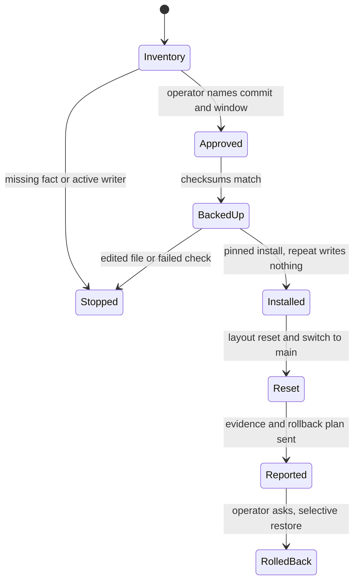

# Mac fresh-view task

The source installer retires old panels without resetting live views. An existing Mac window moves to the fresh view through two pasted tasks. The first is read-only inventory. The second backs up the profile, installs an approved pinned source, resets the shipped `main` layout and reports evidence. The second runs only after the operator approves the inventory and names the commit.



Both tasks keep every custom mod the approved source still ships, and every personal layout as saved. A kept mod leaves the Mac only through a later source change. Shipped `main` shows machines, Herdr's agent list, tabs and panes. Custom mods declare `place: none`, so the agent strip and agent naming run only in a personal layout that names them. Adding them to a clone of `main` is a separate operator decision that these tasks never make.

Several writers can restore a retired mod. When Herdr delegation is on, the sandbox watchdog installs this source's `main` on every cycle. When it is off, the watchdog's older pane installer writes Pots instead. `chezmoi apply` from the dotfiles source restores old mods and keys, and a profile sync between Macs can copy them back. The approved commit must therefore be on this source's `main`, and the reset waits until each other writer is paused or removed by its owner.

## Inventory task

Paste this task into the Mac thread only when the coordinator clears the BOAT and model windows:

```text
Inspect the running Herdr window for the fresh-view reset. This task authorizes read-only inventory only. Stop after reporting it. Do not install, reset, reload, close panes, stop agents, change labels, run chezmoi apply, or restart Herdr, pots sessions, relay, watcher, gateway or router. Do not sign, push, call a model, or upload raw config.

Use the existing herdr-app and hc tools. If either is unavailable, report that and stop. Run herdr-app status, herdr-app ls and herdr-app commands, and record the installed app version. Use hc's read-only listing to record terminal addresses with their herdr.space, herdr.tab and pots worker labels, and count the agent conversations. Do not print command arguments, conversation text, credentials or unrelated labels.

Establish the active absolute HERDR_APP_HOME from the running app's supported metadata. Do not assume the shell's environment describes the running window. If the profile cannot be established without guessing, report that and stop. Read its installed AGENTS.md and command declarations and confirm that layout.reset and layout.switch accept name=main through herdr-app do. Record the selected layout name.

In that profile, list the mod folder names. For agent-notify, my-tabs, usage, command-center, command-center-changes, pots and pots-terminals, count the files and name those that .agent-herdr/receipt.json does not list. Report whether the receipt exists and how many entries it has. List each layout with the mod names it references, and report core-saved mod panes by ID separately from layout blocks. Report keys.json bindings whose action names a retired mod or session-picker, by key and action only. Confirm that agent-strip, agent-naming, current-session, magpie and session-picker are installed, and name the layouts that reference them. Never close a terminal pane to hide a mod.

Identify every writer that can restore a retired mod, without changing its owner. Report the herdrEnabled value from ~/.config/agent-sandbox/provisioning.json and no other key from that file. Report the branch, HEAD and clean state of the agent-herdr checkout the watchdog installs from, and whether the watchdog is scheduled. Report how many chezmoi-managed paths fall under the Herdr profile, without applying, and whether anything schedules chezmoi apply. Name any profile sync between Macs that includes the Herdr profile, and whether it is running. If the native app offers no read-only way to establish a fact, report it as missing.

STOP. Send a concise report with only names, IDs, counts and commits, with private machine and account names redacted:
hc exec --on mastermind pots wake --from mac-thread --note 'HERDR RESET: inventory only; reset not run; <sanitized findings and missing facts>'
Replace the bracketed text with the findings. This is the only remote write authorized by this task.
```

## Reset task

Paste this task only after the coordinator relays the operator's approval of the inventory report. Replace `APPROVED_COMMIT` with the full approved commit on this source's `main`, and `IDLE_WINDOW` with the agreed time window.

```text
Run the approved Herdr fresh-view reset. The operator approved it for commit APPROVED_COMMIT during IDLE_WINDOW. If either placeholder is unreplaced, the time is outside the window, or the inventory report listed an unresolved writer or missing fact, stop and report. Do not close terminal panes, stop agents, change labels, edit personal layouts, run chezmoi apply, or restart Herdr, pots sessions, relay, watcher, gateway or router. Do not sign, push, call a model, or upload raw config or backups.

1. Gates. Use the HERDR_APP_HOME established by the inventory and re-check that layout.reset and layout.switch accept name=main. Confirm herdrEnabled is true, the watchdog's agent-herdr checkout is clean on main with HEAD equal to APPROVED_COMMIT, and git merge-base --is-ancestor APPROVED_COMMIT origin/main succeeds there. Confirm no chezmoi apply is scheduled. Pause the profile sync between Macs for the window. If a gate fails, stop.

2. Snapshot. Create BACKUP_DIR, a new private directory with mode 700 outside every Git checkout. Save the selected layout name and the hc terminal listing from the inventory format into it.

3. Backup. Copy the complete profile into BACKUP_DIR with ditto, including layouts, layouts/.state, view.json, shared.json, settings, keys and .agent-herdr. Write a shasum -a 256 manifest of every file in the live profile and in the copy, and compare them. If Herdr wrote during the copy, copy again at an idle moment until both manifests match. Read every copied file once to prove it is readable. Keep the backup on this Mac.

4. Rehearsal. Copy the backed-up profile to a private scratch directory. In the watchdog's checkout run ./bin/check, then ./bin/update --home SCRATCH --profile desktop --runtime "$HOME/.config/agent-sandbox/herdr-runtime.json", with SCRATCH the absolute scratch path. Record each Installed and Removed line, run it again and confirm it prints nothing. On a Local edit refusal, stop: that file must be imported into source or preserved elsewhere first, and nothing is deleted to force success. Remove the scratch copy afterwards.

5. Install. Run the same command against HERDR_APP_HOME. The installer's lock serializes it with the watchdog. If the watchdog already installed APPROVED_COMMIT, it prints nothing. Otherwise compare its lines with the rehearsal. Run it again and confirm it prints nothing, then run ./bin/check --installed-home "$HERDR_APP_HOME".

6. Rollback plan. Before the reset, write ROLLBACK.md in BACKUP_DIR with the previous selected layout name, the paths step 5 installed or removed, .agent-herdr/receipt.json, and the files a reset can change: layouts/main.json, the main entries under layouts/.state, shared.json and view.json. Give each path's backup location and checksum.

7. Reset. Run herdr-app do layout.reset '{"name":"main"}' and then herdr-app do layout.switch '{"name":"main"}'. If a core-saved pane of a retired mod remains, report its ID and leave it. Removing it needs a command the installed declarations define for mod panes only, and a separate approval.

8. Evidence. Collect herdr-app status without errors and a private screenshot showing machines, the standard agent list and terminals without the Command Center, Pots, notification, tab bar or usage panels. Compare the hc listing with step 2: every address and label is unchanged and the conversation count is the same. Confirm keys.json still binds the session picker shortcut. After the watchdog's next run, confirm the retired mod folders hold only the unlisted files the inventory named. Confirm pot workers are still listed and cleanup still goes through acknowledged results, without terminating a worker to test it. Report whether the agent strip and agent naming appear.

9. Rollback, only when the operator asks within an agreed window. Pause the watchdog through the sandbox owner's supported control. Setting herdrEnabled to false is not a pause, because the older pane installer then writes Pots. Copy back from BACKUP_DIR only the paths ROLLBACK.md lists, check each checksum against the backup, then run herdr-app do layout.switch with the previous layout name. Never copy the whole backup over the profile, which would overwrite newer layout clicks, terminal state and keys. A lasting rollback needs a source revert on main before the watchdog resumes.

Resume the profile sync when the window ends. Report through the same route, without uploading the backup or screenshot:
hc exec --on mastermind pots wake --from mac-thread --note 'HERDR RESET: <done, or stopped at step N and why>; <sanitized evidence>; backup and ROLLBACK.md kept locally in BACKUP_DIR'
```
