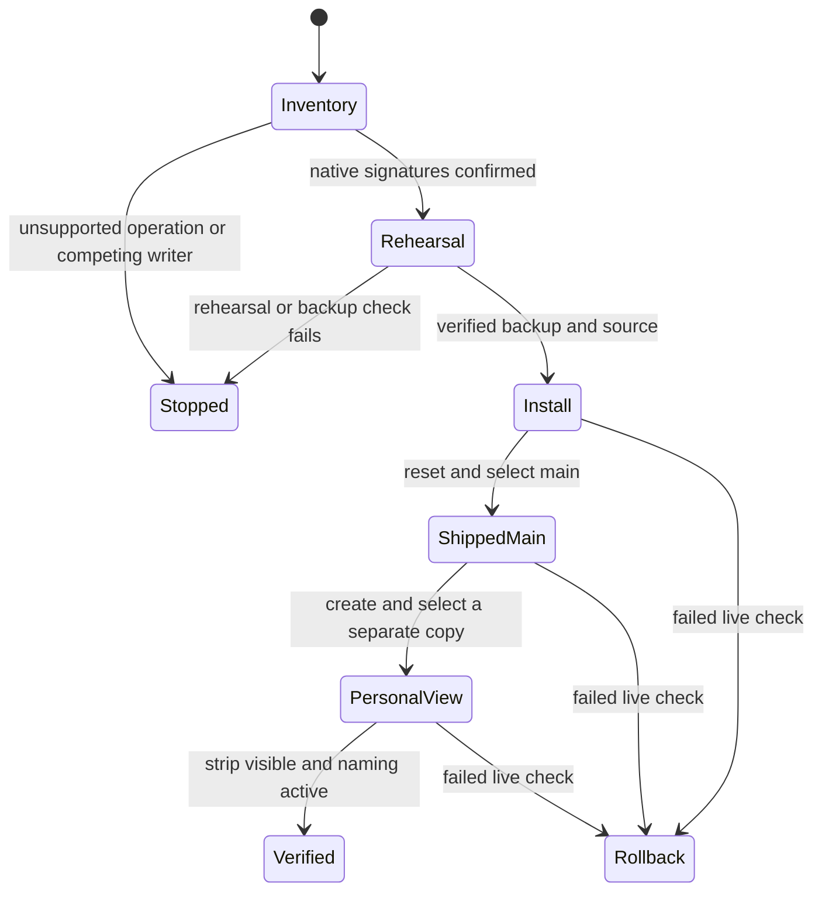

# Mac Studio fresh view

The Mac Studio run starts from shipped `main` and ends on a new personal copy with the custom machine and agent strip visible and agent-naming active. The run needs one operator approval for the pinned source, the idle window and the steps below, including selective rollback if a check fails.



## Ready-to-paste task

Paste after the coordinator relays operator approval and clears the execution window. Fill in `MERGED_MAIN_COMMIT` with the full approved commit on `walid-mos/agent-herdr` main that contains the merged two-mod change. Fill in `IDLE_WINDOW` with the agreed window. The writer paths and handoff are in [Safe cutover](cutover.md#competing-writers).

```text
Run the Mac Studio fresh-view change for MERGED_MAIN_COMMIT during IDLE_WINDOW. The same approval covers creating and selecting a new personal copy of shipped main with agent-strip and agent-naming, and selective rollback if a check fails. Stop if a placeholder is unresolved or the write window is unavailable. Preserve every terminal, conversation, machine registration and existing personal layout. The pinned source keeps only agent-strip and agent-naming as shared custom mods. Let its installer retire the files it can prove it owns. Keep user files, keys and the Magpie service and its private data in place. Keep all backups, raw config, terminal records and screenshots private on this Mac.

1. Read-only inventory. Use the installed herdr-app status, ls, commands and help, and hc's read-only listing. Record the app version, the app's reported active absolute profile, the selected layout, shipped and personal layout names, and the terminal addresses, pane and tab IDs, machine and space assignments, working directories, herdr.space, herdr.tab and worker labels, and conversation IDs or other supported read-only continuity evidence. Keep identifying details local. List layout references separately from core-saved mod pane IDs. Inventory the receipt, kept mods, session-picker keys and files in retired mod folders, including unlisted files. If the app cannot identify the active profile or prove what it would change, stop before writes.

2. Native command gate. Read the installed profile's AGENTS.md and the live command declarations and help. Check whether layout.reset and layout.switch accept name=main on this build. Find the declared command and exact payload for copying the reset main to an unused personal name, and for inserting a row and a nonvisual mount into that copy. The isolated Herdr 0.1.16 rehearsal used layout.clone with {name, as}, then layout.set with {layout} containing the edited copy's tree. Verify those signatures and the tree format on the installed Mac build before using them. If the command targets the selected layout, confirm the personal copy is selected first. Verify the command and payload to select the previous layout. Record a scoped native removal command if one exists. Otherwise plan to leave the copy unselected on rollback. Check that reset, switch, copy and edit affect layout files, saved layout state and selection only, leaving core terminals and conversations in place. Use only the supported native layout commands found on this build, with the verified payloads. Use the old strip and naming placements as geometry references only. The old main-notify mounted agent-strip in a 28 px row and agent-naming in a zero-height block. Use a nonvisual mount the installed build can confirm is active. If any required reset, switch, copy or mount operation is absent, has no documented payload or cannot be scoped as required, report that exact failure and stop before touching the live profile. Do not substitute guessed commands, direct layout JSON edits or a core reset.

3. Source and writer gate. Use a separate clean checkout outside the active profile. Verify git status --porcelain is empty, git rev-parse HEAD matches the full approved commit, and git merge-base --is-ancestor MERGED_MAIN_COMMIT origin/main succeeds against the verified walid-mos/agent-herdr source. Keep source-read credentials out of the installer environment. Verify the watchdog's real Herdr source and whether herdrEnabled is set. Account for scheduled or manual chezmoi apply, the watchdog and profile sync between Macs. Have their owners fence any writer that could apply a different source or change the profile during backup, installation or rollback. The sandbox watchdog can still run the old Pots installer when herdrEnabled is false. At the end, resume only writers verified to use the approved source or to exclude the affected paths. Stop if a competing writer cannot be fenced or if a mutating step would require a restart, closing a pane or changing another machine.

4. Verified backup and rehearsal. In a new local directory outside every checkout with mode 700, record the pre-run inventory and back up the full profile with ditto. Include layouts, layouts/.state, view.json, shared.json, settings, keys and .agent-herdr. Identify core registration and conversation stores through supported app metadata and verify their operator-approved private backup separately if they are outside the profile. Compare relative-path SHA-256 manifests from the source and readable backup, and verify the source stayed stable across the copy. Keep live stores and sockets out of the rehearsal. Run ./bin/check in the pinned checkout. Apply ./bin/update --home "$SCRATCH" --profile desktop --runtime "$RUNTIME" to a disposable profile copy. SCRATCH is its verified absolute path and RUNTIME is the actual absolute private runtime JSON path. Record the changes and confirm a repeat run has no writes. A local edit refusal stops the run with the original files intact. Rehearse the native reset, switch, copy, both mounts and switch-back using an isolated profile and disposable core only if the installed build documents that isolation. Otherwise report the missing isolation support and continue only if step 2 independently verified every live operation and its scope. If a supported rehearsal fails, stop before live changes. Remove only the rehearsal resources you created.

5. Record the rollback and install. Before live writes, record the previous layout, backup hashes and exact targets of the installer and native operations, including prior absence and receipt changes. Reserve an unused personal layout name, default mac-studio-agents. Check the live layout inventory and disk for a name or state collision and choose an unused suffix if needed. Run the pinned update against the active absolute profile, compare with the rehearsal and confirm a second run writes nothing. Run ./bin/check --installed-home against the active profile using the installed app. Record what was actually changed, with post-write hashes or absence, including changes from a partially failed install. Update that record after each native operation. Compare private paths and keys with the inventory before proceeding. Leave any pre-existing Session Picker key entry in place because the installer never tracked individual bindings. If installation or native validation fails, take the rollback path below.

6. Reset, copy and select. Use the verified reset command for shipped main and then the verified switch command to select it. Confirm main is the shipped baseline and record its definition hash after reset. Use the verified copy command and add only the two requested mounts to the fresh personal copy. If insertion targets the selected layout, select the copy and verify its name before inserting either mount. Mount agent-strip as a visible full-width row, and mount agent-naming once without adding visible chrome. Keep the shipped layout's native machine and agent views, tabs and terminal pane structure. Select the personal copy. Confirm the shipped main definition still matches the post-reset hash and the other personal layouts and their saved clicks match the backup. If a retired panel remains because of a core-saved mod pane, record its ID, leave the pane in place and roll back. If a command fails or has a wider effect than expected, stop making forward changes and roll back.

7. Verify and report. Confirm herdr-app status is healthy, the new personal copy is selected, and the machine and agent strip is visible alongside the standard view with no old panels. Save a private screenshot. Verify agent-naming is mounted and check an existing eligible local tab against its already-published title when one is available. Record when there is no eligible tab. Expected tab renames by the mod are compatible with stable tab IDs. Compare terminal addresses, pane and tab IDs, labels, working directories, registrations and conversation evidence with the inventory. Confirm the receipt contains only agent-strip and agent-naming under mods, including the keyboard helper in agent-strip. Verify the receipt-owned or import-hash-matched files of the retired mods are gone and unlisted files survive. Compare keys, other layouts and their existing references with the inventory. Confirm the sandbox's acknowledged-result cleanup remains in place from its existing status or configuration, without exercising it on a worker. Report the app version, verified native signatures, selected layout, observed behavior, skipped isolation check if any, and whether the writers can safely resume.

Rollback within the same approved window if a live step fails. Keep competing writers fenced. Use the verified layout switch and restore only the observed paths or settings changed by this run from the verified backup. For shared settings, restore only the affected selections or fields when unrelated values have changed. If the previous layout needs restored mod or layout files to load, restore those before selecting it. Compare current files with recorded post-write hashes before replacing them. Keep any intervening edits and stop for the operator if you cannot isolate the run's changes. Remove only the new layout and its saved state if the app provides a verified scoped operation and the copy still matches this run. Otherwise leave the copy unselected and report it. Never copy the entire profile back or restore a core store over live sessions. Check terminal and conversation continuity after rollback. Keep a writer paused if resuming it would undo the rollback, and report its owner and the remaining action.

Report sanitized results through the coordinator's existing Mac thread. Include whether the run completed, stopped before live writes or rolled back, the first failed or unavailable operation if any, and where the verified backup and rollback record are kept locally. The report may contain counts, layout and mod names, commands and source commits. Keep private paths, terminal details, screenshots and conversation contents on the Mac.
```
