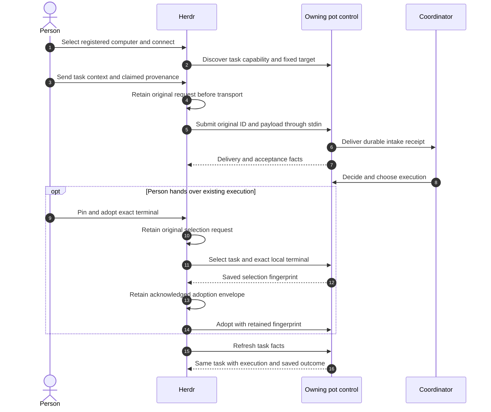

# Send a task to its owning pot

Pot tasks is an optional Herdr dialog for explicit submission, exact terminal adoption and observation of the owning pot's task facts. It uses the normal mod-opening and terminal-opening flow without a Pots pane, Command Center, custom layout or legacy runtime configuration.

Open `mod.open:task-handover`. The default shortcut opens it when that chord is unoccupied. Existing occupied bindings retain their actions. Select the computer from Herdr's machine registrations, enter that pot's absolute installed control path and choose **Connect to selected pot**. The connection is kept privately in the running profile's local storage. Obtain the control path from the pot operator's reviewed installation. This dialog neither registers a machine nor installs control.

Fill **Task context**, **Claimed author** and **Source reference**, then choose **Send task to owning pot**. Include the conversation context needed to continue the work. These fields preserve claims about the source and author. They authenticate nobody and grant no publication, spend, credential or account permission. The bot must explicitly decide whether to accept, reject or request information. A delivered message alone does not mean it has accepted the task.

Select a task to see its separate delivery and acceptance facts, coordinator reason, associated execution, observed progress, publication facts and saved result references. **Refresh task facts** observes again. The open connected dialog also refreshes while it has no failed observation or outstanding request. A failed observation leaves the last successful facts visible and labels the failure. Silence or terminal disappearance never becomes completion in Herdr.

For accepted work without an associated execution, select a visible terminal address or enter its exact local address on the selected pot, then choose **Pin and adopt exact terminal**. The owning control saves a selection for the exact live conversation. Herdr retains the returned fingerprint before adoption and sends only that fingerprint and task identity. The owning control refuses a changed conversation, ambiguity, another pot or an existing conflicting association. Herdr supplies no terminal metadata, cwd, session file, native parent or launch command on adoption. Adoption never starts a replacement. **Open associated terminal** uses Herdr's existing `terminal.peek` operation. **Copy observed task facts** copies the selected row, including its task ID and available outcome references. Saved screen and transcript values are references supplied by control, not local files that Herdr opens automatically.

## Ownership and failure behavior

The [sandbox task contract](https://github.com/walid-mos/agent-sandbox/blob/b90eb4eb38a7f042b200da7daa7cb2e95fa25c28/docs/task-handover.md) owns intake validation, decisions, worker relationships, execution matching and the shared snapshot/report projection. Its protocol module is the authority for the wire version. Herdr declares the version it understands and refuses unsupported capability or task-row versions. The integrated fixture compares that declaration with the pinned sandbox source. Herdr calls only the operations required for submission, selection, adoption and snapshot observation. It neither schedules workers nor derives bot task states.

The dialog owns only its transient selection and the original retry inputs. Local storage retains a submission's ID, complete payload, fixed target and control endpoint before intake. It separately retains the original selection request and the acknowledged adoption envelope before adoption. The envelope contains only the supported version, task ID and backend-issued selection fingerprint. No worker status, decision, progress or outcome is persisted by Herdr. Those facts always come from the owning pot's row. Another dialog cannot overwrite changed retry inputs, and each submission or adoption attempt checks that they still match durable storage.

| Failure | What remains |
| --- | --- |
| Missing or incompatible task capability | Submission stays disabled pending the compatible sandbox rollout. |
| Local storage cannot retain the request | Submission or adoption does not start. |
| Lost submission or adoption reply | The exact original request remains available for retry after refresh or reconnect. |
| Lost selection reply | Recovery reads the saved selection from the owning pot's snapshot and retains it before adoption. |
| No acknowledged saved selection | Adoption stays blocked for inspection without repeating selection. |
| Same terminal changes conversation | Adoption is refused while the original selection stays pinned. |
| Another dialog changes retry inputs | The stale dialog refuses transport until reopened. |
| Changed target or control endpoint | Retry is refused until the original connection is restored. |
| Backend refusal | The diagnostic is displayed and the original request is retained for inspection. |
| Failed observation | The last successful facts remain visibly marked as an earlier observation. |
| Herdr exits during transport | The retained request survives in local storage, and an interrupted transport may leave a private request file for operator inspection. |

**Retry original submission** reuses the full saved envelope. **Retry pinned adoption** reuses the saved fingerprint without selecting again. **Recover selection and adopt** first acknowledges and retains the backend's saved selection. Recovery refuses an absent or mismatched selection, including a selection request lost before the backend saved it. Normal transcript appends that preserve conversation identity remain valid. **New task** becomes available only after the retained submission's delivery has been observed. It explicitly starts a different request and does not amend the prior intake. Do not clear private retry storage to work around an uncertain outcome. Inspect the owning pot and preserve the original request until it is reconciled. Coordinator discussion, decisions, worker selection and final-result attestation use the pot's existing communication route.

| Trusted principal | Untrusted input |
| --- | --- |
| The installed Herdr process, operator-selected connection and installed owning-pot control | Task text, claimed provenance, observed terminal content and displayed task facts |

JSON crosses stdin through a private request file and a fixed program with positional arguments. Task text never supplies shell code, control paths, transport destinations or authority. The selected machine and control endpoint are private operator inputs. This adds no process, credential or filesystem isolation against another process running as the same user. Existing Herdr and pot permissions remain in force.

## Source verification and activation

Run the repository source check. Run the task probes with `HERDR_TASK_SANDBOX_SOURCE` pointing to the reviewed sandbox checkout and `node --experimental-test-module-mocks --test probes/task-*.mjs`. The fixture helper pins the exact sandbox revision and imports its actual representative harness and protocol module. An unexpected source revision fails before fixture setup, requiring review of the dependency change. Run the sandbox's focused task suite alongside this adapter suite to retain its delivery, adoption, queue and security coverage.

The integrated probes use real control, dispatch, queue, worker inspection, reporting projection and result entry points. Herdr's host transport, coordinator decisions, external commands and Discord API are simulated. The local stdin shell and JSON transport run for real. The fixture owns its temporary home and synthetic executions and removes them on completion. Setup, execution and cleanup measurements are separate diagnostics. These checks prove no native rendering, keyboard focus, screen-reader announcements, remote registration or live Discord interaction.

Activation requires the parent interface review, applicable review gates, native Herdr checks and the normal approved sandbox and Herdr source rollout. An explicit review waiver covers only the named review gate and grants no activation permission. The installed sandbox must advertise the compatible capability before submission or adoption is enabled. PR1's retirement of the old panels and PR43's worker visibility are not dependencies. Preserve active terminals, conversations, parent topology, layouts, registrations and runtime state throughout rollout. Source publication alone activates nothing.
